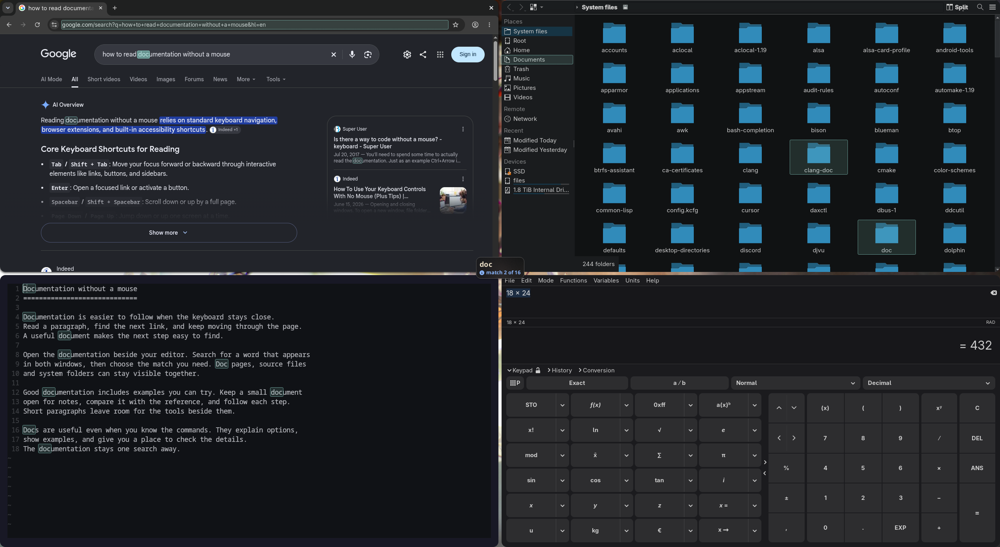

#  wayhint

[](https://github.com/tkutsu/wayhint/actions/workflows/ci.yml)
[](#license)

Click anything on your Hyprland desktop from the keyboard. Type a word you see
and press `Enter`, or type the hint on a button with no text.




## Install

```sh
cargo install --locked --git https://github.com/tkutsu/wayhint
wayhint doctor
```

It needs Rust 1.88 or newer. `wayhint doctor` checks the rest and says how to
fix what fails. Then bind it in your Hyprland config:

```lua
hl.bind("SUPER + W", hl.dsp.exec_cmd("wayhint"))
```

## Make apps visible

wayhint reads the accessibility tree that screen readers use. Apps that hide
theirs still get hints, guessed from their pixels and drawn in teal.

| App | Setup |
|---|---|
| Qt | `hl.env("QT_LINUX_ACCESSIBILITY_ALWAYS_ON", "1")` in your Hyprland config |
| Chromium, Electron | `--force-renderer-accessibility` in `~/.config/chromium-flags.conf` or `electron-flags.conf` |
| GTK, Firefox | Nothing, or `gsettings set org.gnome.desktop.interface toolkit-accessibility true` if controls are missing |
| Kitty | `allow_remote_control socket-only` and `listen_on unix:${XDG_RUNTIME_DIR}/kitty-{kitty_pid}.sock` in `kitty.conf` |

Reopen an app after changing its setup.

## Keys

| Key | Action |
|---|---|
| Letters | Search text or type a hint |
| `Enter` | Click the match |
| `Tab` | Next match |
| Arrows | Nearest match, or move the pointer |
| `Esc` | Close |
| `/` | Show every key |

Type a capital first to change the click: `R` right, `M` middle, `D` double,
`O` hover, `H` drag. `wayhint --hints` shows a hint on every control.

## Settings

`wayhint config --default` prints every option with an explanation. Put the
ones you change in `~/.config/wayhint/config.toml`.

## License

[MIT](LICENSE-MIT) or [Apache-2.0](LICENSE-APACHE). The pixel detector builds on
[wl-kbptr](https://github.com/moverest/wl-kbptr) and
[Neru](https://github.com/y3owk1n/neru) ([notice](src/pixels/LICENSE-NERU)).
The Hyprland protocol in [protocols/](protocols/) is BSD 3-clause.
