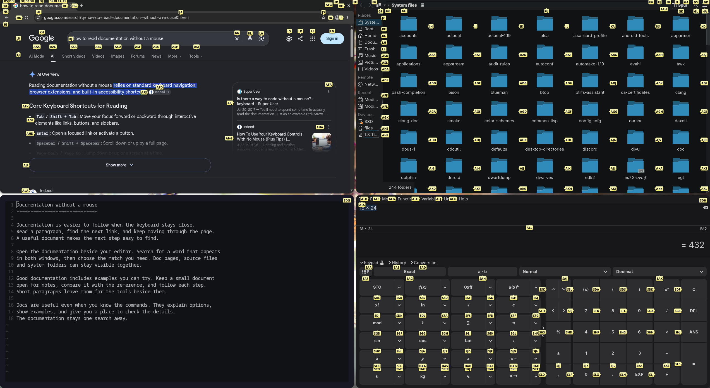

#  wayhint

[](https://github.com/tkutsu/wayhint/actions/workflows/ci.yml)
[](#license)

Click things on your Hyprland desktop without the mouse.

Type a word you can see on screen and press `Enter` to click it. Icons and
buttons with no text get short letter hints, so you type the hint instead.
It works across every window on the focused monitor.


`wayhint --hints` puts a hint on every control, so you only type hints.



It's early and only runs on Hyprland. I've only tested it on one monitor at
scale 1.

## Install

You need Rust 1.88 or newer, `libxkbcommon`, `fontconfig` and `at-spi2-core`.

```sh
cargo install --locked --git https://github.com/tkutsu/wayhint
wayhint doctor
```

`wayhint doctor` checks your setup and tells you how to fix whatever fails.

Bind it in your Hyprland config:

```lua
hl.bind("SUPER + W", hl.dsp.exec_cmd("wayhint"))
```

Press the binding again or `Esc` to close it.

## Let apps show their controls

wayhint finds controls through the accessibility bus that screen readers use.
Apps that don't publish anything there still get hints, guessed from their
pixels and drawn in teal.

Add this to your Hyprland config so Qt apps join the bus:

```lua
hl.env("QT_LINUX_ACCESSIBILITY_ALWAYS_ON", "1")
```

Chromium, Chrome and Electron apps need `--force-renderer-accessibility`. On
Arch, put it on its own line in `~/.config/chromium-flags.conf` and
`~/.config/electron-flags.conf`.

GTK and Firefox usually work as they are. If their controls are missing, run:

```sh
gsettings set org.gnome.desktop.interface toolkit-accessibility true
```

Quit an app completely and reopen it after changing its flags. For Chromium
that includes its background processes. `wayhint dump --surfaces` shows how
many hints each window got, which helps you spot one that's missing.

## Search terminal text in Kitty

Add this to `~/.config/kitty/kitty.conf`, then quit Kitty and start it again:

```conf
allow_remote_control socket-only
listen_on unix:${XDG_RUNTIME_DIR}/kitty-{kitty_pid}.sock
```

Anything that can reach that socket can read and control Kitty.

## Keys

| Key | Action |
|---|---|
| Letters | Search visible text, or type a hint. |
| `Enter` | Click the current match. |
| `Tab`, `Shift+Tab` | Move between matches. |
| Arrows | Pick the nearest match in that direction, or move the pointer. |
| `Ctrl` or `Alt` with `Enter` | Click with that key held. |
| `Esc` | Close. |
| `/` | List every key. |

A capital letter before the target changes the click: `R` right-click, `M`
middle-click, `D` double-click, `O` hover, `H` hold to drag. For example,
`Dsave` then `Enter` double-clicks "save".

Clicking a text field closes wayhint so you can type. Anything else starts a
new round, so you can keep going. Use `wayhint --once` to close after one
click.

## Configuration

Settings go in `~/.config/wayhint/config.toml`, and you only need the ones you
change. Every option is explained in [config.default.toml](config.default.toml).

```sh
wayhint config --default > ~/.config/wayhint/config.toml
```

That writes a commented copy of the defaults and overwrites the file, so only
run it once. `wayhint config` checks your settings and prints what they
resolve to.

## Troubleshooting

Run `wayhint doctor` first. The log is at `~/.local/state/wayhint/wayhint.log`,
and failures from a keybind also show up as notifications.

`wayhint dump` prints what wayhint sees as JSON. It can contain private text
from your windows.

Pixel hints are guesses, so they can miss a control or point at decoration.
Menus that were already open when wayhint started aren't seen. Several
monitors and rotated displays are untested.

## License

[MIT](LICENSE-MIT) or [Apache-2.0](LICENSE-APACHE), at your option.
The pixel contour detector is based on
[wl-kbptr](https://github.com/moverest/wl-kbptr). The colour pass is ported
from [Neru](https://github.com/y3owk1n/neru), whose MIT notice is in
[src/pixels/LICENSE-NERU](src/pixels/LICENSE-NERU). The Hyprland protocol in
[protocols/](protocols/) carries its BSD 3-clause notice.
