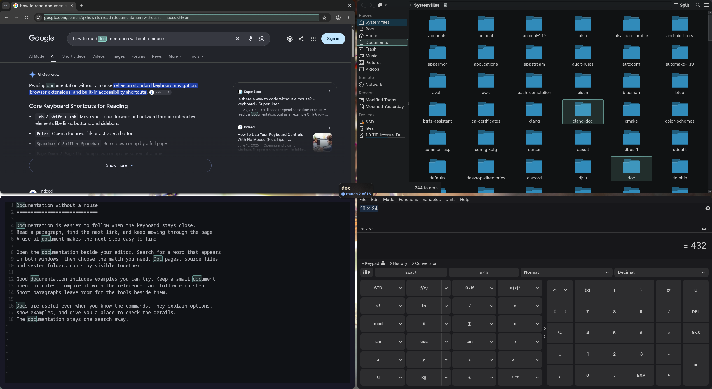
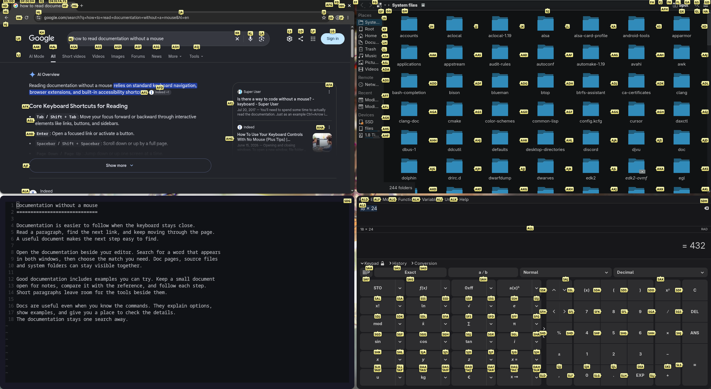

#  wayhint

[](https://github.com/tkutsu/wayhint/actions/workflows/ci.yml)
[](#license)

Use your keyboard to click what you see on a Hyprland desktop.

Launch `wayhint`, type a word on screen, and press `Enter` to click it.
Icons and controls without searchable text keep short letter hints: type a
hint to reach those too. Text and hints work together across the visible
windows on the focused monitor.

wayhint reads the accessibility tree used by screen readers, plus Kitty's
remote control. Windows without accessible controls get hints estimated
from their pixels. These use teal letters because they are guesses.

Early development, Hyprland only. The author's daily setup is one monitor
at scale 1; other monitor arrangements are untested.

## In action

Real Wayhint overlays across Chromium, Dolphin, Neovim and Qalculate!.
The workspace uses a fresh browser profile, system files and sample
documentation, with Wayhint's default styling: yellow gradient hints with
borders and soft shadows. Click either preview to watch the WebM.

Type `doc` to find matching text across the browser, file manager and
editor. Teal boxes mark matches, with a stronger fill on the current one.
Use `Tab` to choose one, then `Enter` to click.

[](docs/images/text-search.webm)

[Watch text search (WebM)](docs/images/text-search.webm) | [Full-resolution screenshot](docs/images/text-search.png)

Launch `wayhint --hints` to label every control, including icon buttons.
Type a label to click its target.

[](docs/images/keyboard-hints.webm)

[Watch keyboard hints (WebM)](docs/images/keyboard-hints.webm) | [Full-resolution screenshot](docs/images/keyboard-hints.png)

## Requirements

- Hyprland, with a working Wayland session and session D-Bus.
- Rust 1.88 or newer to build, plus libxkbcommon and fontconfig (`fc-match`).
- `at-spi2-core` for the accessibility bus, and apps with accessibility
  enabled. Setup instructions are below.
- Kitty and its `kitten` command if you want to search terminal text.
  Other terminals have no text source unless they expose it through AT-SPI.

The overlay and clicks require layer-shell, xdg-shell and the virtual
pointer protocol. Hyprland normally provides these. The input-method
protocol lets wayhint read keys without closing an app's menus; if it is
unavailable or already held by fcitx or IBus, wayhint takes keyboard focus
instead. Modifier clicks need the virtual keyboard protocol. Pixel hints
use Hyprland's window-export protocol; fractional scaling uses viewporter.

## Install and launch

```sh
cargo install --locked --git https://github.com/tkutsu/wayhint
wayhint doctor
```

From a clone, `cargo build --release` produces `target/release/wayhint`.
`wayhint doctor` checks your config, compositor, Wayland protocols,
accessibility bus, fonts and Kitty connection, and explains failed checks.

Bind it in `hyprland.conf`:

```conf
bind = SUPER, W, exec, wayhint
```

For a Lua config:

```lua
hl.bind("SUPER + W", hl.dsp.exec_cmd("wayhint"))
```

Press the binding again to close wayhint. `Esc` closes it too. Clicking a
text field ends the run so you can type into the app; other verified
controls usually start another round. `--once` exits after one action.

For a separate hints-only binding, launch `wayhint --hints`. Each launch
stays in its chosen mode; launching the other mode switches to it. An
empty workspace keeps listening for controls to appear.

## Enable accessibility

Apps must publish their controls on the AT-SPI bus for accurate hints and
searchable text. Start with `wayhint dump --surfaces`: it lists windows
and their hint counts, which helps identify apps missing from the tree.

| App | Setup |
|---|---|
| GTK 4 | Usually works without changes. Make sure `GTK_A11Y=none` is not set. |
| GTK 3 and Firefox | Usually work without changes. If controls are missing, enable toolkit accessibility with the command below. |
| Qt, including Dolphin and Quickshell | If controls are missing, launch with `QT_LINUX_ACCESSIBILITY_ALWAYS_ON=1`. |
| Chromium, Chrome and Electron | Launch with `--force-renderer-accessibility`. On Arch, Chromium reads `~/.config/chromium-flags.conf`; put the flag on its own line. Electron apps may need it added to their launcher command. |
| Kitty | Enable remote control as described below. |

To enable the GNOME toolkit setting, where its schema is installed:

```sh
gsettings set org.gnome.desktop.interface toolkit-accessibility true
```

For Qt apps, you can put this in `hyprland.conf` before starting them:

```conf
env = QT_LINUX_ACCESSIBILITY_ALWAYS_ON,1
```

Fully quit and reopen affected apps after changing flags or environment
variables. Chromium's existing background processes and PWAs must exit
too: opening another window can reuse a process without the new flag.
Apps started before the accessibility bus, or left running through a bus
restart, may also need reopening. There is no need to restart the bus to
apply these settings.

See the upstream [Chromium accessibility guide](https://www.chromium.org/developers/design-documents/accessibility/)
and [Qt accessibility documentation](https://doc.qt.io/qt-6/qaccessible.html)
for their activation rules.

## Enable Kitty remote control

Kitty has no accessibility tree. wayhint reads its pane text and cursor
position through a local socket, using `kitten`. Add these lines to
`~/.config/kitty/kitty.conf`:

```conf
allow_remote_control socket-only
listen_on unix:${XDG_RUNTIME_DIR}/kitty-{kitty_pid}.sock
```

Save your terminal work, fully quit Kitty, then launch it again. Reloading
its config does not create the socket. Each Kitty process gets its own
socket; programs it starts inherit the address in `KITTY_LISTEN_ON`.

Run `wayhint doctor` again to check the connection. Remote control enables
text searches and, with `[pixels] terminal_hint = true`, a hint at the
active pane's cursor. Without a usable
connection, or when the cursor is hidden, the focus hint sits 10 px from
the window's left and bottom edges. This fallback uses the pixel hint
color; a reported cursor uses the normal hint color. Remote control is
still required for searchable text. Its quick-access panel is a layer
surface and is not searched.

`socket-only` accepts control through the socket and rejects requests
through the terminal. Programs able to connect to that socket can read
and control Kitty. See [Kitty's remote-control settings](https://sw.kovidgoyal.net/kitty/conf/#opt-kitty.listen_on).

## Text and hints

Type the beginning of a visible word: `con` finds "contact" and "Control",
while `save fi` continues into the next word. Case and accents are
ignored, so `cafe` finds "Café". Spaces match whitespace and line breaks.
Punctuation can start a query too. If the first symbol is also a verb,
both interpretations stay available: with `_` bound to hold, `_hello`
finds `_hello.md` for the default action and `hellooooo` for hold. Use
`Tab` to choose, then `Enter` to act. Icon buttons are also searchable by
their accessibility names. A name match highlights the button and acts
at its center, even when the name is not drawn. By default,
`[words] icon_names = false` searches a
button's name only when its screenshot appears to show letters. Set
`icon_names = true` to search names without a screenshot; hint placement
and pixel target detection still use them. The items of an open menu are
searched by their names.

Set `[words] match_start = "word"`, `"line"` or `"sentence"` to choose where
matching can begin. The default, `"word"`, searches from any word start.
`"line"` searches from the first word after each line break in the text;
visually wrapped rows continue the same line. `"sentence"` searches from
the first word of each Unicode sentence. Leading whitespace and opening
punctuation can be skipped, or you can type the opening punctuation too.
Each text object starts a new line and sentence. Queries can continue
across word and line boundaries. First-character markers follow the
selected setting.

Standard mode relies on typing for Latin text by default, including accented
letters. Targets whose text contains letters from another writing system
also get hints. Add scripts you can type with `[words] scripts = ["Latin", "Greek"]`.
The list replaces the default; Unicode script names and codes such as
`"Grek"` are accepted. Mixed text gets a hint unless every script is listed.
Numbers and punctuation need no extra script. This uses writing systems, so
French and Spanish text count as `"Latin"` too. Text in every script remains
searchable if you type it. These hints follow `[words] fallback_hints`;
`--hints` still tags every control.

Matches get teal boxes, with a stronger fill on the current match, and the
pointer moves onto the current match. Text is read when a round starts,
and again whenever the windows change while nothing is typed. Once you type, it stays as read until the
next round. Before acting, wayhint reads the selected text again and
skips the action if it changed.

| Key | Action |
|---|---|
| `Enter` | Act on the current match. With nothing typed, act at the pointer. |
| `Tab`, `Shift+Tab` | Move between matches, taking the pointer along. |
| Arrows | Select the nearest match in that direction without wrapping. With nothing typed, just a verb, or no match, move the pointer. Hold to repeat. |
| A complete hint | Act on a control without searchable text. |
| `Backspace` | Edit the query; with it empty, cancel the armed verb. |
| `Ctrl` or `Alt` held on `Enter` | Apply that modifier to the click. |
| `/` | With nothing typed, list the keys. |
| `Esc` | Exit, or release a held mouse button first. |

Hints use letters that no searchable word starts with. Typing therefore
narrows both text and hints until one identifies a target. By default,
hints act as soon as they are complete, and text matches
wait for `Enter`. `[hints] auto_accept` and `[words] auto_accept` change
each.

### Verbs

A verb changes the next action. In text mode, type its key before the
query: `Dsave Enter` double-clicks "save". Named keys work at any point.
In hints-only mode, a verb can come anywhere before the hint's last letter.

Verb bindings accept capitals such as `R`, symbols such as `,`, `.`, `"`
and `_`, or named keys such as `Home`, `PageDown` and `Space`. Lowercase letters
and digits are rejected. A capital leaves its lowercase letter to the
hints. Repeat and help follow the same binding rules. Close can also use
a lowercase letter. `default_action` chooses the action for a bare tag.

| Default key | Action |
|---|---|
| No verb | Left click. |
| `R` | Right click. |
| `M` | Middle click. |
| `D` | Double click. |
| `O` | Hover, leaving the pointer there. |
| `Home`, `End` | Mouse back, forward. |
| `PageUp`, `PageDown` | Immediately scroll the focused window up, down by two notches. |
| `H` | Hold the left button; the next target releases it there to drag. |
| `Space` | Repeat the last command on its target. |

Named or capital scroll keys act immediately in either mode, without a
hint or `Enter`. In text mode, a symbol bound to scroll follows the same
literal-or-verb matching rule.
`Ctrl` and `Alt` apply to the scroll. Other verbs stay armed when pressed
again; use Enter with nothing typed to act at the pointer. The repeat key
repeats the last command on its target. In text mode, it repeats only when
the query is empty; otherwise its character becomes part of the query.
The close key releases a hold in place.
These defaults describe a US layout. Keys are matched by position using
your first keyboard layout; a default that produces a lowercase letter or digit on
that layout stays unbound. `wayhint config` shows the actual bindings.

With nothing typed, just a verb, or no text match, the arrows move the
pointer itself, 10 pixels per press, faster when held. In hints-only mode,
they always move the pointer. Pointer movement stops 5 pixels inside the
monitor's edge; during a hold the arrows drag.
Held arrows share one motion, so two arrows move diagonally without
alternating between axes. Releasing the arrows stops the current movement.
Pointer travel is animated, including returns to the saved position.
By default, selecting a text match leaves the cursor in place until an
action is triggered. Set `[pointer] move_on_select = true` to move it as
the selection changes through typing, Tab or arrows. In hints-only mode,
`Enter` acts at the pointer when no hint is typed, or
confirms a completed hint. An incomplete hint does nothing on Enter.
Space can be bound to a verb, for example `hover = "Space"` under `[keys]`.
With Space bound to repeat, it inserts a space into a nonempty text query.
An unbound Space always types a space. `/` shows the key legend.
Hold `Ctrl` or `Alt` on the hint's last letter to apply it, or on `Enter`
when confirmation is on. Shift is never held through a click.

## Configuration

Settings live in `~/.config/wayhint/config.toml`. Create the directory first
if needed. Print a commented starting file with:

```sh
wayhint config --default > ~/.config/wayhint/config.toml
```

This replaces that file, so use it only when starting a new config.
`wayhint config` validates your existing settings and prints the resolved
values. The [default config](config.default.toml) documents every option.
A small example:

```toml
[keys]
hover = '"'
hold = "_"
repeat = "Q"

[hints]
size = 10
auto_accept = false

[words]
cursor = "start"
auto_accept = true     # act on a unique match after 3 characters

[pointer]
scroll_steps = 2
```

Wayhint leaves the cursor where it ended up. Set
`[pointer] restore_on_exit = true` to return it to its launch position when
the session ends. Set `[pointer] restore_on_action = true` to return it to its
pre-command position after each action while the session is running.
This leaves hover in place and defers restoration during a hold until
release. The default is `false`. The old `after = "restore"` and
`after = "leave"` values are still accepted as `true` and `false`, respectively.

Each window has a hint near its top right, moved clear of other hints and
small controls where space permits. It focuses the window without clicking
and has no arrow. It is hidden whenever a verb is armed or a drag is active.
Set `[hints] window_hint = false` to disable it. Terminal cursor hints are off
by default; enable `[pixels] terminal_hint = true` to show them as well
(with a bottom-left fallback when the cursor cannot be read).

Keep only your overrides. Omitted settings use defaults. The input uses a
centered, translucent dark box with 18 px text and rounded corners,
inheriting the hints' font and shadow.
Match boxes inherit the hints' radius, with their own colors and padding.
`[words.matches.current]` uses a stronger teal fill and outline. Other match
settings and an explicitly set match border are inherited. An explicit
`background` makes the current match solid unless `background_end` is also set.

Under `[keys]`, `default_action = "left"` chooses what a bare tag or Enter
with nothing typed does. Set a shortcut to a key, or `false` to disable it; empty strings are
rejected. For example, `default_action = "right"` makes a bare tag right-click,
and `left = "."` gives left-click a shortcut. The close key must stay bound.

Set `[hints] auto_accept = false` to confirm completed hints with
`Enter`, in either mode. Set `[words] fallback_hints = false` to show only text
matches. `[input] show_typed_hints` controls whether typed tag letters move
into the input box. `[messages]` controls the status messages below it;
their visibility is independent of `[input] visible`. `[input] autohide = 3`
hides the typed line after three seconds without typing, keeping the query active;
use `0` to keep it visible. `[messages] size = 13` keeps messages small even with
larger input text. Other durations use `_ms`, and pointer distances and merge
distance use `_px`.

No-match messages remain visible until corrected: a text query must match text
or a fallback hint, or be cleared. A rejected tag message stays until the next
meaningful input. `duration_ms` is accepted for compatibility but no longer
expires these messages. Message visibility still follows `[messages] visible`.
The current match and total appear on the message line, for example `match 1 of 3`,
using `info_icon` and `info_color`. Warnings and help take priority over the count.

Appearance is configured under `[hints]`, `[words.matches]`,
`[words.first_character]`, `[input]` and `[messages]`; colors accept hex RGB or RGBA.
`text` colors hint letters; `verb` colors the armed verb in hints and the input.
Invalid settings are reported before wayhint takes the keyboard.

Hints default to bold black letters on a pale yellow vertical gradient, with
an 11 px font, rounded gray borders and soft shadows. Pixel hints use dark teal letters.
Set `shadow = "#00000000"` under `[hints]` to hide the shadow.
Use `shadow_offset = [0, 2]` for its displacement in logical pixels (right, down)
and `shadow_size = 3` for its outward fade distance. A size of `0` gives a hard
edge. `[hints.pixels]` and `[input]` can override these settings. To keep the
shadow below the input's top edge, make its downward offset at least its size.
Shadows stay outside the rounded box so translucent backgrounds keep an even fill.

Hint backgrounds and letters can each use a gradient. `gradient = "hint"`
(the default) repeats it inside each tag. Use `gradient = "global"` to span
each monitor, visible only inside the tags or letters:

```toml
[hints]
gradient = "global"
background = "#1e1e2ef0"
background_end = "#45475af0"
background_direction = "right"
text = "#ffffffff"
text_end = "#94e2d5ff"
text_direction = "bottom-right"
```

Directions point toward the second colour: `left`, `right`, `top`, `bottom`,
`top-left`, `top-right`, `bottom-left` or `bottom-right`. Text defaults to
`right`, backgrounds to `bottom`. An explicit `text` or `background` without
its `_end` field is solid. Setting either colour in `[hints.pixels]` makes
that part of pixel hints solid too. The gradient setting applies to both
backgrounds and letters. Typed letters, armed verbs and the input box use
solid colours.

Word match boxes use the same monitor-wide gradients under `[words.matches]`
and `[words.matches.current]`: set `background_end` and `background_direction`.
First-character markers share `color`, `color_end` and `direction` under
`[words.first_character]`, whether the shape is an underline, box or dot:

```toml
[words.matches]
background = "#1e1e2ec8"
background_end = "#45475ac8"
background_direction = "bottom-right"

[words.first_character]
mark = "underline"
color = "#89b4faff"
color_end = "#94e2d5ff"
direction = "right"
```

The `[words]` tables control searchable words; the `text` color fields under
`[hints]` and `[input]` control rendered letters.

A hint tries just outside its target: left, below, above, then right,
centered along the chosen edge. `[hints] max_cover = 50` sets how much of each
neighboring target or hint's area it may cover, as an integer percentage from
0 to 100 (default 50). Set it to 0 to avoid covering neighbors or 100 to allow full
coverage. Between hints, the percentage applies to the smaller label. A hint
with too much overlap tries another position. Aligned rows and columns keep
their shared placement even when hints overlap beyond the limit.
Aligned columns share the left or right side nearest the screen edge;
aligned rows share top or bottom.
One blocked hint keeps the group's side. Two or more blocked hints make
the whole group try another side. Shared placements stay anchored,
including while typing. If every side is blocked, the group centers its
hints inside the controls. A filled pointer joins the hint's nearest edge,
using the hint's background gradient and border by default. It points toward
the target and touches it when the target is within the configured length.
Configure its `color`, `outline`, `length` and `outline_width` under
`[hints.arrow]`. Set `length = 0` to hide arrows. Centered fallbacks have no arrow.
Set `[hints] position` to a point such as `"bottom-right"` to put every
hint there instead.
Hints for layer surfaces, including bars, can use space outside the surface
while staying on the monitor.
`[hints] hide_hidden = true` (the default) omits controls whose accessibility
provider reports full transparency. Set it to `false` to include them.
Unknown visibility is kept: Firefox reports Sidebery's transparent close
buttons as opaque, so those may still get hints.
`[words.first_character] mark = "underline"`, `"box"` or `"dot"` marks the first
character of each word that text mode can find, while nothing is typed.
`thickness` sets the underline height or dot diameter. Dots sit centered one
logical pixel below the character. Box borders, radius and padding keep their
own settings; use alpha in `color` to make the fill translucent.

## Limits and troubleshooting

Pixel hints estimate controls from shapes and words; they can miss a
control or point at decoration. They do not provide searchable text.
Clicking one ends the run, and its final check verifies the window's
position and visibility rather than the control's identity.

A menu that was already open when wayhint started is not seen. Some apps
expose only an item's name, so its whole box is highlighted rather than
individual letters.
Overlapping controls inside an app and some layer-shell popups cannot be
resolved reliably. Several monitors and rotated displays are untested.

For setup problems, run `wayhint doctor`. To inspect what an app exposes,
use `wayhint dump` or `wayhint dump --text`; their JSON can contain private
screen text. Routine diagnostics go to
`~/.local/state/wayhint/wayhint.log` (or `$XDG_STATE_HOME/wayhint/wayhint.log`).
Failures launched from a keybind also appear as desktop notifications.

## License

[MIT](LICENSE-MIT) or [Apache-2.0](LICENSE-APACHE), at your option.
Contributions are licensed under the same terms unless explicitly stated
otherwise. The pixel contour detector and filtering rules are based on
[wl-kbptr](https://github.com/moverest/wl-kbptr). The colour pass is ported
from [Neru](https://github.com/y3owk1n/neru), whose MIT notice is in
[src/pixels/LICENSE-NERU](src/pixels/LICENSE-NERU). The Hyprland protocol
in [protocols/](protocols/) carries its BSD 3-clause notice.
